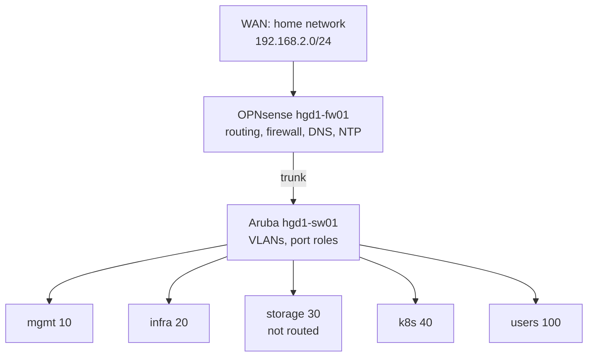

# Concepts

How the site network is built and why. Read [Network design](design.md)
first; the other pages assume it.

## Layers

1. **WAN.** The home network is the outside world; nothing from it reaches
   the site unless a forward allows it.
2. **Router.** Routes between VLANs, enforces the [firewall](../reference/firewall.md),
   serves [DNS and time](dns-and-time.md).
3. **Switch.** Carries the VLANs to each port by role.
4. **VLANs.** Management, hosts, storage, Kubernetes and users, each its own
   subnet. See [Network design](design.md).

## Decisions

??? note "The uplink on the router's onboard NIC, never on the switch"

    WAN traffic never touches the switch, so the home network can't leak
    into the internal VLANs through a misconfigured port.

??? note "Storage is not routed"

    VLAN 30 has no router address: only machines with a leg in it can reach
    Ceph, and a router problem never touches storage traffic.

??? note "Default deny between VLANs"

    Every path between VLANs is a rule, so the firewall table is a complete
    list of what may talk to what.

??? note "The third octet is the VLAN ID"

    `10.10.<vlan>.0/24`: reading an address tells you which network it's on.

??? note "Remote access through Cloudflare, not port forwards"

    No inbound ports for admin access: the hosts' tunnel and WARP (cluster
    docs). The only WAN forwards are for game streaming from home.

## Concept pages

- :lucide-network: [**Network design**](design.md): VLANs, wiring, switch ports, firewall summary
- :lucide-clock: [**DNS and time**](dns-and-time.md): Unbound, host overrides, NTP

