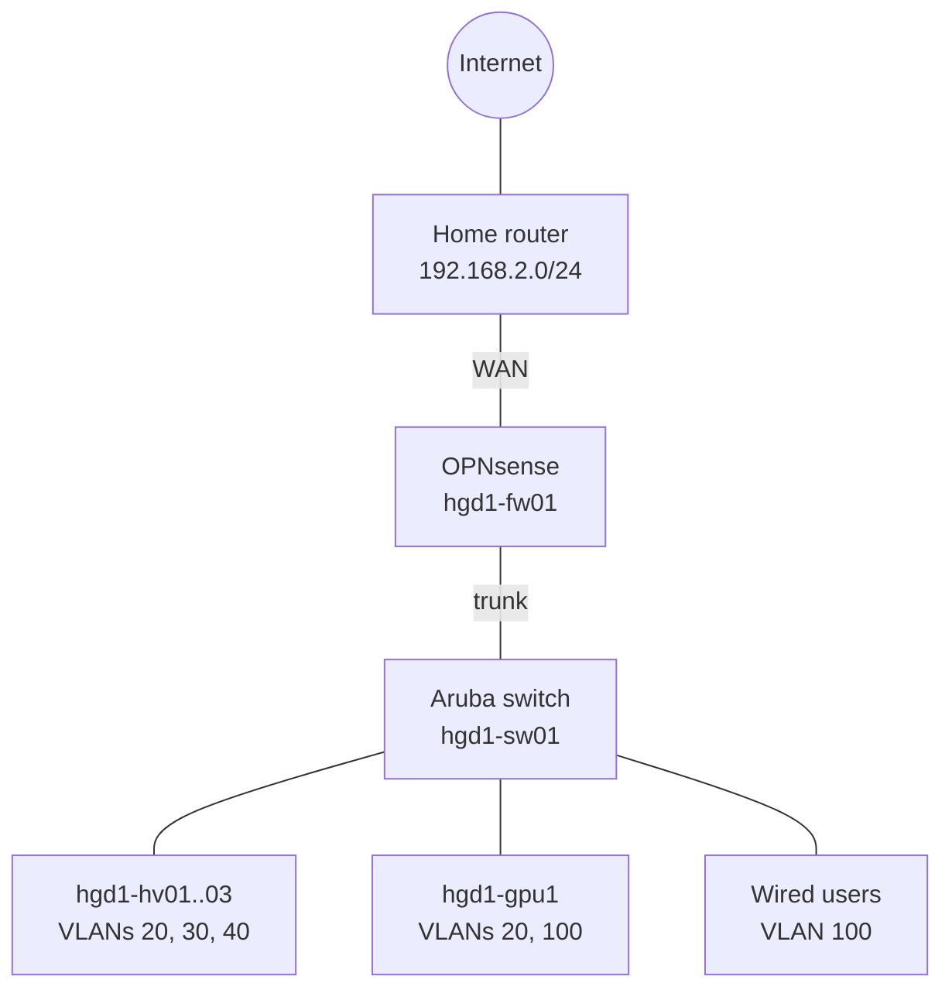

# hgd1 Network

The site network of hgd1: the OPNsense router `hgd1-fw01`, the Aruba switch
`hgd1-sw01`, five VLANs and the firewall between them. The router and switch
are configured by hand today; Ansible in this repo
([`hgd1-network`](https://github.com/jurrebuunk/hgd1-network)) is
[planned](https://github.com/jurrebuunk/hgd1-network/blob/main/PLAN.md).

The hgd1 docs are three sites, each covering only what its repo owns:

<a class="site site--cluster" href="https://jurrebuunk.github.io/nix-hgd1-cluster/"><svg xmlns="http://www.w3.org/2000/svg" fill="none" stroke="currentColor" stroke-linecap="round" stroke-linejoin="round" stroke-width="2" viewBox="0 0 24 24"><rect width="20" height="8" x="2" y="2" rx="2" ry="2"/><rect width="20" height="8" x="2" y="14" rx="2" ry="2"/><path d="M6 6h.01M6 18h.01"/></svg>Clusternix-hgd1-clusterHosts, Ceph, S3, microVMs, the k3s nodes, monitoring, remote access, the Platform API and <code>labctl</code>.Open the docs <svg xmlns="http://www.w3.org/2000/svg" fill="none" stroke="currentColor" stroke-linecap="round" stroke-linejoin="round" stroke-width="2" viewBox="0 0 24 24"><path d="M5 12h14M12 5l7 7-7 7"/></svg></a>
<a class="site site--k8s" href="https://jurrebuunk.github.io/hgd1-k8s/"><svg xmlns="http://www.w3.org/2000/svg" fill="none" stroke="currentColor" stroke-linecap="round" stroke-linejoin="round" stroke-width="2" viewBox="0 0 24 24"><circle cx="12" cy="12" r="8"/><path d="M12 2v7.5M19 5l-5.23 5.23M22 12h-7.5M19 19l-5.23-5.23M12 14.5V22M10.23 13.77 5 19M9.5 12H2M10.23 10.23 5 5"/><circle cx="12" cy="12" r="2.5"/></svg>Kuberneteshgd1-k8sWhat runs on k3s: Flux, public access, Postgres, Keycloak, and how to run an app.Open the docs <svg xmlns="http://www.w3.org/2000/svg" fill="none" stroke="currentColor" stroke-linecap="round" stroke-linejoin="round" stroke-width="2" viewBox="0 0 24 24"><path d="M5 12h14M12 5l7 7-7 7"/></svg></a>

<svg xmlns="http://www.w3.org/2000/svg" fill="none" stroke="currentColor" stroke-linecap="round" stroke-linejoin="round" stroke-width="2" viewBox="0 0 24 24"><rect width="6" height="6" x="16" y="16" rx="1"/><rect width="6" height="6" x="2" y="16" rx="1"/><rect width="6" height="6" x="9" y="2" rx="1"/><path d="M5 16v-3a1 1 0 0 1 1-1h12a1 1 0 0 1 1 1v3M12 12V8"/></svg>Networkhgd1-networkThe OPNsense router, the Aruba switch, the VLANs and the firewall between them.You're here

-   :lucide-rocket:{ .lg .middle } **Get started**

    ---

    Reach the router and switch, make a first change safely, tour the repo.

    [:octicons-arrow-right-24: Get started](get-started/index.md)

-   :lucide-lightbulb:{ .lg .middle } **Concepts**

    ---

    The VLAN design, the trunk, DNS and time, and why.

    [:octicons-arrow-right-24: Concepts](concepts/index.md)

-   :lucide-wrench:{ .lg .middle } **How-to guides**

    ---

    Add a DNS override or a firewall rule, change a switch port.

    [:octicons-arrow-right-24: How-to](how-to/index.md)

-   :lucide-heart-pulse:{ .lg .middle } **Operate**

    ---

    The health check, the router and switch, and rebuilding the network.

    [:octicons-arrow-right-24: Operate](operate/index.md)

-   :lucide-book-open:{ .lg .middle } **Reference**

    ---

    Firewall policy, addresses and switch ports, credentials, the plan.

    [:octicons-arrow-right-24: Reference](reference/index.md)

-   :lucide-life-buoy:{ .lg .middle } **Troubleshooting**

    ---

    Find the fix by symptom: no access, DNS, blocked traffic, missing logs.

    [:octicons-arrow-right-24: Troubleshooting](operate/troubleshooting.md)

## At a glance

| Part | Status | Read |
| --- | --- | --- |
| OPNsense router, Aruba switch | Done | [Router and switch](operate/router-and-switch.md) |
| VLANs 10, 20, 30, 40, 100 | Done | [Network design](concepts/design.md#vlans) |
| Firewall policy and WAN forwards | Done | [Firewall](reference/firewall.md) |
| DNS (Unbound) and NTP | Done | [Network design](concepts/design.md#dns-and-time) |
| Configuration as Ansible | Planned | [PLAN.md](https://github.com/jurrebuunk/hgd1-network/blob/main/PLAN.md) |

## I want to…

| … | Go to |
| --- | --- |
| understand the VLANs | [Network design](concepts/design.md) |
| know whether traffic between two VLANs is allowed | [Firewall](reference/firewall.md) |
| look up an address or switch port | [Addresses](reference/addresses.md) |
| log in to the router or switch | [Router and switch](operate/router-and-switch.md#access) |
| fix "can't reach anything" | [Troubleshooting](operate/troubleshooting.md#no-access) |
| rebuild the network after a loss | [Rebuild the network](operate/rebuild.md) |
| look up a host or VM address | [Cluster addresses](https://jurrebuunk.github.io/nix-hgd1-cluster/reference/addresses/) (cluster docs) |

## Conventions

- Commands run on the laptop with WARP connected, unless they say otherwise.
- Look before you change: back up the router and switch first. Exports stay
  outside Git; they contain password hashes and keys.
- Addresses of hosts and VMs come from `inventory.nix` in `nix-hgd1-cluster`;
  DNS overrides here follow it.
