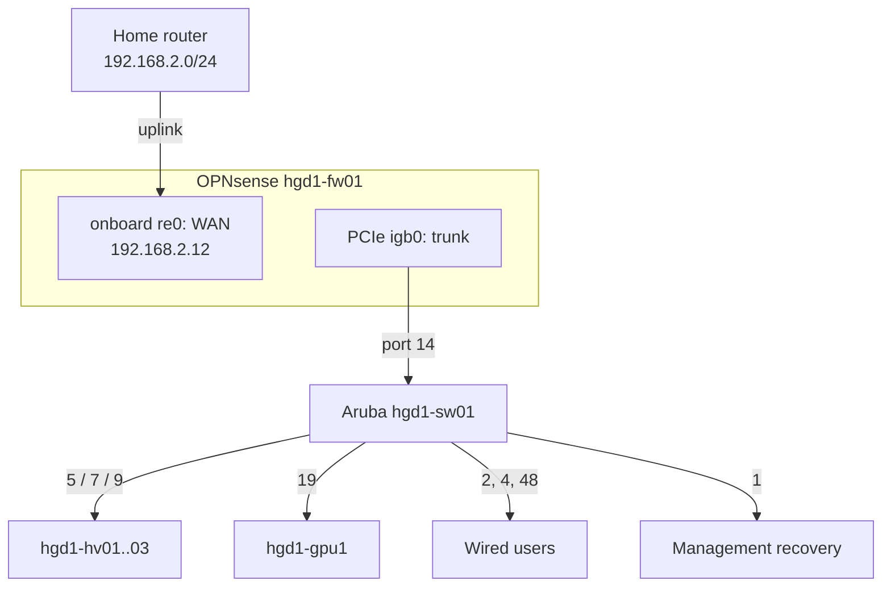

# Network

The site network of hgd1: the OPNsense router `hgd1-fw01`, the Aruba switch
`hgd1-sw01`, the VLANs and the firewall between them. The hgd1 docs are three
sites, each covering only what its repo owns:

<a class="site site--cluster" href="https://jurrebuunk.github.io/nix-hgd1-cluster/"><svg xmlns="http://www.w3.org/2000/svg" fill="none" stroke="currentColor" stroke-linecap="round" stroke-linejoin="round" stroke-width="2" viewBox="0 0 24 24"><rect width="20" height="8" x="2" y="2" rx="2" ry="2"/><rect width="20" height="8" x="2" y="14" rx="2" ry="2"/><path d="M6 6h.01M6 18h.01"/></svg>Clusternix-hgd1-clusterHosts, Ceph, S3, microVMs, the k3s nodes, monitoring, remote access, the Platform API and <code>labctl</code>.Open the docs <svg xmlns="http://www.w3.org/2000/svg" fill="none" stroke="currentColor" stroke-linecap="round" stroke-linejoin="round" stroke-width="2" viewBox="0 0 24 24"><path d="M5 12h14M12 5l7 7-7 7"/></svg></a>
<a class="site site--k8s" href="https://jurrebuunk.github.io/hgd1-k8s/"><svg xmlns="http://www.w3.org/2000/svg" fill="none" stroke="currentColor" stroke-linecap="round" stroke-linejoin="round" stroke-width="2" viewBox="0 0 24 24"><circle cx="12" cy="12" r="8"/><path d="M12 2v7.5M19 5l-5.23 5.23M22 12h-7.5M19 19l-5.23-5.23M12 14.5V22M10.23 13.77 5 19M9.5 12H2M10.23 10.23 5 5"/><circle cx="12" cy="12" r="2.5"/></svg>Kuberneteshgd1-k8sWhat runs on k3s: Flux, public access, Postgres, Keycloak, and how to run an app.Open the docs <svg xmlns="http://www.w3.org/2000/svg" fill="none" stroke="currentColor" stroke-linecap="round" stroke-linejoin="round" stroke-width="2" viewBox="0 0 24 24"><path d="M5 12h14M12 5l7 7-7 7"/></svg></a>

<svg xmlns="http://www.w3.org/2000/svg" fill="none" stroke="currentColor" stroke-linecap="round" stroke-linejoin="round" stroke-width="2" viewBox="0 0 24 24"><rect width="6" height="6" x="16" y="16" rx="1"/><rect width="6" height="6" x="2" y="16" rx="1"/><rect width="6" height="6" x="9" y="2" rx="1"/><path d="M5 16v-3a1 1 0 0 1 1-1h12a1 1 0 0 1 1 1v3M12 12V8"/></svg>Networkhgd1-networkThe OPNsense router, the Aruba switch, the VLANs and the firewall between them.You're here

The site separates management, hosts, storage, Kubernetes and users into
VLANs behind one OPNsense router.

!!! info "At a glance"

    **Status** Done (built by hand; Ansible in this
    repo is [planned](https://github.com/jurrebuunk/hgd1-network/blob/main/PLAN.md)) ·
    **Addresses** [Addresses](addresses.md) · **Rules** [Firewall](firewall.md)

## Overview

The internet uplink goes into the router's **onboard NIC**, never into the
switch, so WAN traffic never touches the switch and the home network can't
leak into the internal VLANs. The whole home network counts as WAN: nothing
from home reaches the site unless a rule allows it.

## VLANs

The site uses `10.10.0.0/16`, and the third octet is always the VLAN ID.

| VLAN | Name | Subnet | Gateway | DHCP | What lives there |
| --- | --- | --- | --- | --- | --- |
| 10 | mgmt | `10.10.10.0/24` | `.1` | `.100–.199` | Router, switch |
| 20 | infra | `10.10.20.0/24` | `.1` | no | Hypervisors, `hgd1-gpu1` |
| 30 | storage | `10.10.30.0/24` | none | no | Ceph; **not routed** |
| 40 | k8s | `10.10.40.0/24` | `.1` | no | k3s VMs, API VIP `.10`, load balancers `.200–.249` |
| 100 | users | `10.10.100.0/24` | `.1` | `.100–.249` | Wired users, the gaming VM |

`10.42.0.0/16` and `10.43.0.0/16` stay free for k3s pods and services. The
storage VLAN never reaches the router: only hosts and VMs with a leg in it
can talk Ceph.

## How it works

### Host wiring

Each hypervisor has one cable carrying VLAN 20 untagged and VLANs 30 and 40
tagged. What the hosts do with it (bridges for the VMs, their own
firewall) is on the cluster docs.

!!! cluster "On the cluster docs: host network"

    How NixOS splits the trunk into `br-stor` and `br-k8s`, and the ports the
    hosts and VMs open.

    [Host network](https://jurrebuunk.github.io/nix-hgd1-cluster/concepts/network/){ .md-button }

### Switch ports

| Role | Ports | Untagged | Tagged |
| --- | --- | --- | --- |
| Router trunk | 14 | 10 | 20, 40, 100 |
| Hypervisors | 5, 7, 9 | 20 | 30, 40 |
| `hgd1-gpu1` | 19 | 20 | 100 |
| Wired users | 2, 4, 48 | 100 | – |
| Management recovery | 1 | 10 | – |
| Spare router links | 16, 18 | 999, disabled | – |
| Everything else | – | 999, disabled | – |

Port order says nothing about which host is plugged in; confirm by MAC.

### Firewall

Everything between VLANs is denied unless allowed. In short: mgmt reaches
everything; infra, k8s and users reach the internet and the router's DNS and
NTP; users also reach Kubernetes load balancers on 80 and 443; the three
hypervisors may forward into mgmt, k8s and users for remote access. The full
table is in [Firewall](firewall.md).

### DNS and time

OPNsense runs Unbound with DNSSEC for `lan.buunk.org` and serves NTP. Fixed
addresses have host overrides such as `hgd1-hv01.lan.buunk.org`,
`s3.lan.buunk.org`, `k8s.lan.buunk.org`, `mon.lan.buunk.org`,
`api.lan.buunk.org` and `lab.buunk.org` (internal for now). Hosts also keep each other in
`/etc/hosts`, so they resolve each other when the router is down. Ceph needs
synced clocks, so hosts run chrony and prefer OPNsense.

### Game streaming

My gaming VM on `hgd1-gpu1` runs Sunshine. Home Moonlight clients connect to
the router's WAN address `192.168.2.12`, which forwards the Sunshine ports to
`10.10.100.50`. On the users VLAN, use `10.10.100.50` directly. The admin UI,
RDP and discovery are not forwarded.

!!! warning "Keep \"Block private networks\" off on WAN"

    The WAN *is* a private network (my home LAN), so that checkbox would block
    the streaming forwards. Default deny plus the narrow forwards protect the
    site.

## Configuration

| What | Where |
| --- | --- |
| VLANs, DHCP, DNS overrides, firewall, NAT on OPNsense | This repo (Ansible, [planned](https://github.com/jurrebuunk/hgd1-network/blob/main/PLAN.md)) |
| VLANs and port roles on the Aruba | This repo |
| Host and VM addresses | `inventory.nix` in [`nix-hgd1-cluster`](https://github.com/jurrebuunk/nix-hgd1-cluster); keep the DNS overrides here in step with it |

The router and switch are not managed by Nix. Their exports are backed up as
files outside Git, because they contain password hashes and keys.

## Operating

- What's configured and how to reach the devices: [Router and switch](router-and-switch.md).
- Building it all again: [Rebuild the network](rebuild.md).

## Troubleshooting

See [Troubleshooting](troubleshooting.md).

## Related

- [Addresses](addresses.md) · [Firewall](firewall.md)
- On the cluster docs: [Remote access](https://jurrebuunk.github.io/nix-hgd1-cluster/concepts/remote-access/) (Cloudflare tunnel and WARP into these VLANs)
- Future ideas (Wi-Fi, guest and IoT VLANs, DMZ, LACP) are on the
  [roadmap](https://jurrebuunk.github.io/nix-hgd1-cluster/reference/roadmap/).
